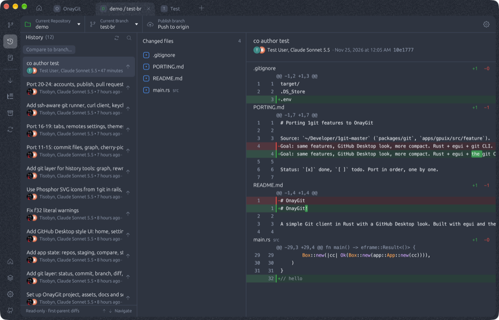
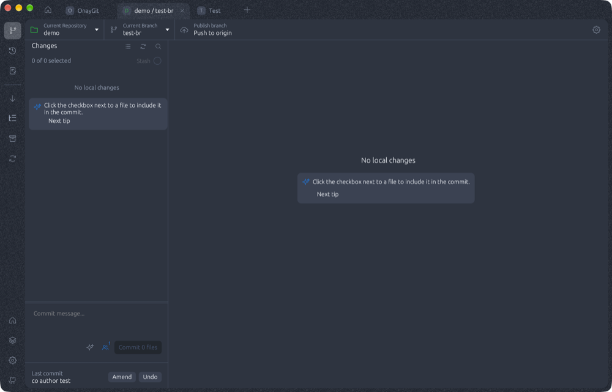
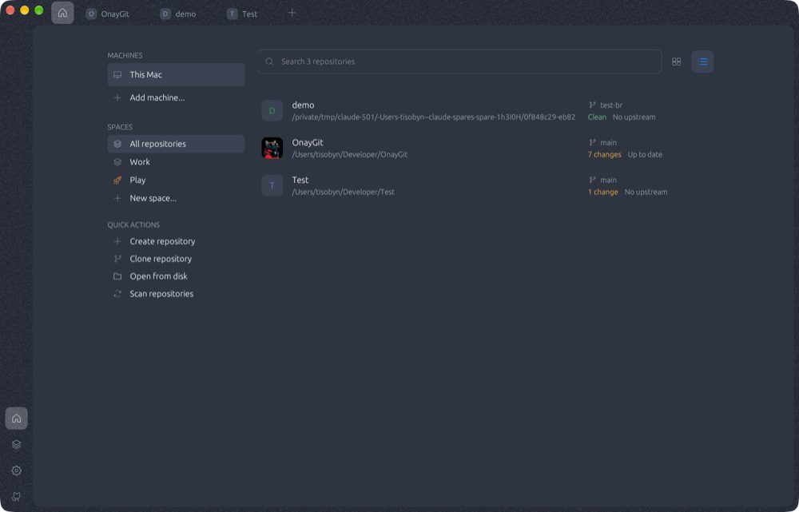
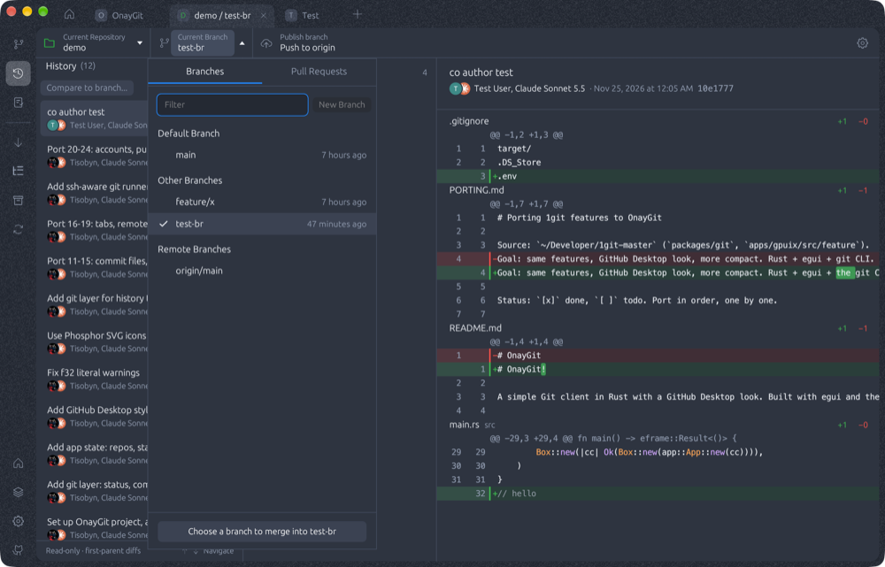
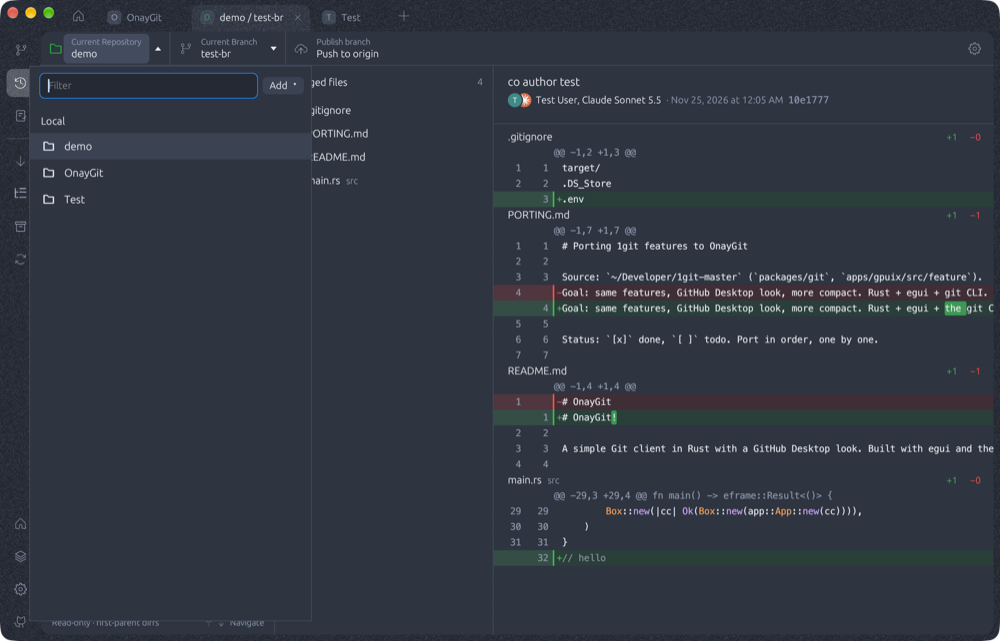
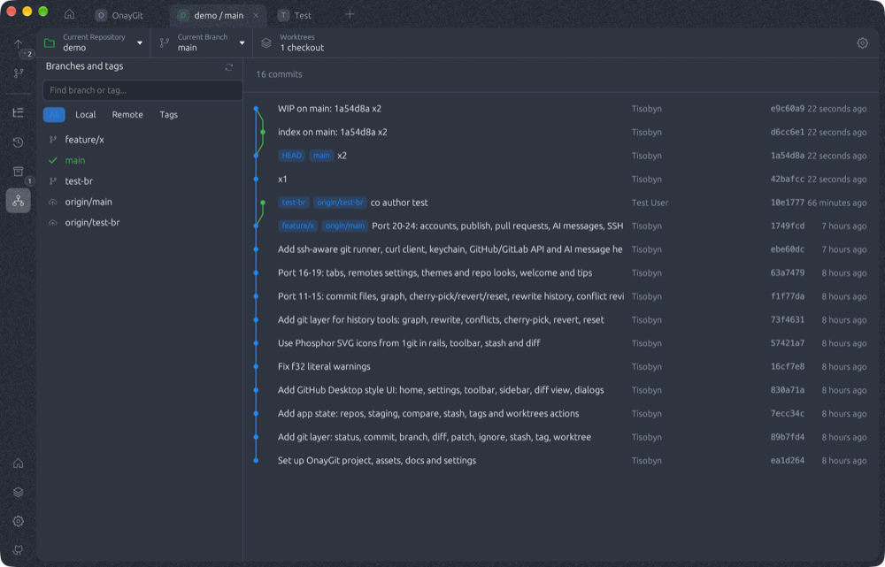
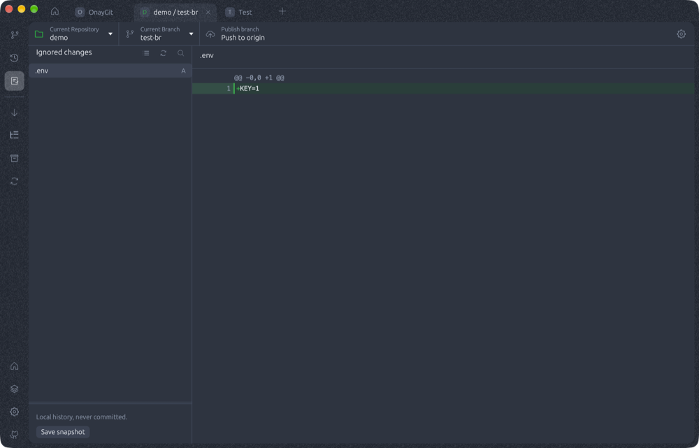
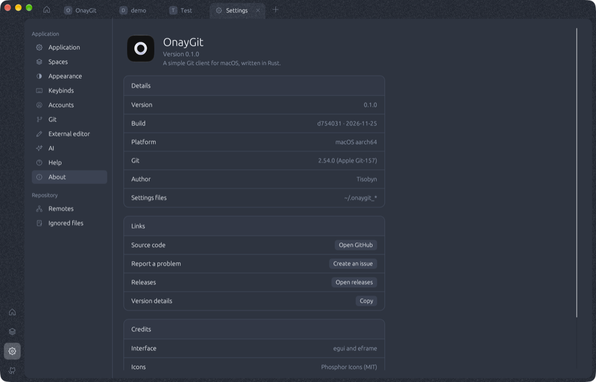

<div align="center">


# OnayGit

**A fast, calm Git client for the Mac. Rust, egui and the plain `git` command.**

[](https://github.com/Tisobyn/OnayGit)


<br>



</div>

---

## Why OnayGit

- **Native speed.** One small Rust binary. No Electron, no web view.
- **Real git underneath.** It runs your own `git`, so results always match the terminal.
- **Clear on screen.** Stage by file, hunk or single line. Read diffs with word highlight and syntax colours.
- **Many repos, one window.** Tabs, spaces (groups of repos), and repositories on other machines over SSH.

## Screenshots

<table>
  <tr>
    <td width="50%"><br><sub><b>Changes.</b> Stage files, hunks or lines. Commit, amend, undo.</sub></td>
    <td width="50%"><br><sub><b>Home.</b> All repositories, spaces, machines and quick actions.</sub></td>
  </tr>
  <tr>
    <td width="50%"><br><sub><b>Branches.</b> Switch, create and merge. Right-click to delete.</sub></td>
    <td width="50%"><br><sub><b>Repositories.</b> Filter, jump between repos, add new ones.</sub></td>
  </tr>
  <tr>
    <td colspan="2"><br><sub><b>Graph.</b> Every branch and tag on the left, the whole commit graph on the right. Click a commit to open it in History.</sub></td>
  </tr>
  <tr>
    <td width="50%"><br><sub><b>Ignored changes.</b> Local history for files git ignores, like <code>.env</code>.</sub></td>
    <td width="50%"><br><sub><b>Settings.</b> Themes, accounts, AI, editors, shortcuts and more.</sub></td>
  </tr>
</table>

## Features

| | |
|---|---|
| **Changes** | File list or tree, line and hunk staging, commit, amend, undo last commit, discard, ignore |
| **Conflicts** | Block by block editor: ours, theirs, both or edit by hand |
| **History** | Commit graph, search (words, author, file, dates), changed files column, pictures and co-authors, tag, cherry-pick, revert, reset, reword, squash |
| **Side rail** | One sync button (fetch, pull, push, publish) with ahead/behind badge, pull requests, Changes, History, Stashes, Graph |
| **Branches** | Switch, create, merge, delete, compare, worktrees, stash |
| **Remotes** | Fetch, pull, push, publish to GitHub or GitLab, pull requests |
| **Organise** | Tabs (drag to reorder), spaces with icons and colours, quick switcher, SSH machines |
| **Ignored changes** | Save snapshots of ignored files and see what changed |
| **AI** | Write a commit message with your own provider or command |
| **Live** | File watcher updates the window at once. `onaygit .` opens a folder in the running app |
| **Look** | 5 themes, accent colours, fonts, optional grain |

## Install

You need a Mac, [Rust](https://rustup.rs) and `git`.

```bash
git clone https://github.com/Tisobyn/OnayGit.git
cd OnayGit
cargo run --release
```

### Build the app

```bash
scripts/package.sh
```

This makes `dist/OnayGit.app` (about 7 MB) and `dist/OnayGit-<version>-macos.zip` (about 3 MB), signed ad hoc so it runs on your Mac. For other Macs, sign it with your own Developer ID.

The optional [`gh`](https://cli.github.com) tool is used to find profile pictures and for pull requests.

## Shortcuts

| Keys | Action |
|---|---|
| `Cmd+T` | New tab (Home) |
| `Cmd+W` | Close tab |
| `Cmd+1` ... `9` | Go to tab |
| `Cmd+P` | Switch repository |
| `Cmd+F` | Filter files |
| `Cmd+,` | Settings |

All shortcuts can be changed in Settings > Keybinds.

## Commit pictures and co-authors

History rows show the author and any `Co-authored-by` people with round profile pictures. Pictures come from the GitHub CLI, GitHub noreply emails or Gravatar and are cached in `~/.onaygit_avatars`. You can turn them off in Settings > Appearance.

The people icon in the commit box adds co-authors to the next commit. Choices are saved in `~/.onaygit_coauthors`.

## License

[MIT](LICENSE). Icons are [Phosphor](https://phosphoricons.com) (MIT).

## Where your data lives

Settings are plain files in your home folder (`~/.onaygit_*`). Tokens are in the macOS Keychain. Nothing is sent anywhere except to the git hosts you sign in to.

## Version and About

Settings > About shows the version, build (git hash and date), platform, git version, links and credits. The version comes from `Cargo.toml`.

<details>
<summary><b>Project layout</b></summary>

```
src/
  main.rs            window setup and icon
  prelude.rs         common imports used by every module
  settings.rs        saved settings and repository list (files in ~/)
  keybinds.rs        shortcut list, saved overrides, key capture
  app/
    mod.rs           App state, enums and the update loop
    repos.rs         open/add/remove repos, refresh, stage, background jobs
    staging.rs       line/hunk staging, compare, ignore actions
    refs.rs          stash, tag and worktree actions
    history.rs       commit actions, rewrite, conflicts
    tabs.rs          tabs and per-repository color/icon
    spaces.rs        spaces (repository groups)
    tasks.rs         background tasks (network, AI, ssh) and their results
    accounts.rs      GitHub/GitLab accounts (tokens in the Keychain)
    hosting.rs       publish repository, pull requests
    ai.rs            AI commit messages
    machines.rs      SSH machines
    editors.rs       external editors and per-file-type rules
    ignored.rs       ignored files and their local snapshots
  git/               thin wrappers over the git command (no UI code)
    exec.rs          run git, with or without stdin
    status.rs        status, stage, unstage, discard, file diff
    commit.rs        commit, amend, undo, log
    branch.rs        branches, checkout, merge, ahead/behind, compare
    diff.rs          parse unified diffs into numbered lines
    patch.rs         build and apply partial patches (has tests)
    ignore.rs        .gitignore helpers
    stash.rs         stash list, push, apply, pop, drop
    remote.rs        remotes (has tests)
    tag.rs           tags
    worktree.rs      worktrees (has tests)
    graph.rs         commit graph lanes
    rewrite.rs       reword, squash, drop (non-interactive rebase)
    conflict.rs      merge/rebase state, conflict resolution (has tests)
    repo.rs          init, scan for repositories
    config.rs        git config
    external.rs      open in editor, show in Finder
    images.rs        old version of image files for the diff
    ssh.rs           repositories on other machines (ssh://host/path)
    http.rs          small HTTP client over curl
    keychain.rs      secrets in the macOS Keychain
    hosting.rs       GitHub/GitLab API (has tests)
    ai.rs            AI providers for commit messages (has tests)
  ui/                drawing code, one file per screen area
    theme.rs         5 themes and accent colors
    widgets.rs       small reusable widgets
    diff_view.rs     diff renderer with line selection
    home.rs          start screen (no repo open)
    settings_page.rs settings screens
    toolbar.rs       top bar: repo, branch, sync
    toolbar_menu.rs  repository and branch dropdown panels
    sidebar.rs       Changes and History tabs
    main_panel.rs    diff of the selected file or commit
    dialogs.rs       confirm dialogs and the error bar
    stash.rs         stashed changes list in the Changes tab
    manage.rs        Tags, Worktrees and Reword windows
    history.rs       History tab: commit list, files, context menu
    graph.rs         draws one graph row
    conflicts.rs     conflict banner
    icons.rs         Phosphor icons from 1git (assets/icons)
    tabs.rs          tab bar and Cmd+T / Cmd+W
    settings_repo.rs Remotes and repository appearance pages
    welcome.rs       first-run welcome window
    clone.rs         full-page Clone (account repositories or URL)
    syntax.rs        small syntax highlighter for diffs
    shell.rs         window frame: title bar tabs, left rail, rounded card
    switcher.rs      Cmd+P repository switcher
    accounts_page.rs Accounts and AI settings pages
    publish.rs       Publish, Pull requests, Add machine, machine view
assets/              app icon (from 1git)
docs/                notes: TODO, AUDIT, REVIEW, TEST_REPORT, PORTING, CHANGELOG
```

Rule of thumb: git commands live in `git/`, drawing lives in `ui/`, state lives in `app/`.

</details>

---

<div align="center"><sub><a href="https://github.com/Tisobyn/OnayGit">github.com/Tisobyn/OnayGit</a> · <a href="https://github.com/Tisobyn/OnayGit/issues">Issues</a><br>Made by Tisobyn. Inspired by GitHub Desktop and 1git.</sub></div>
